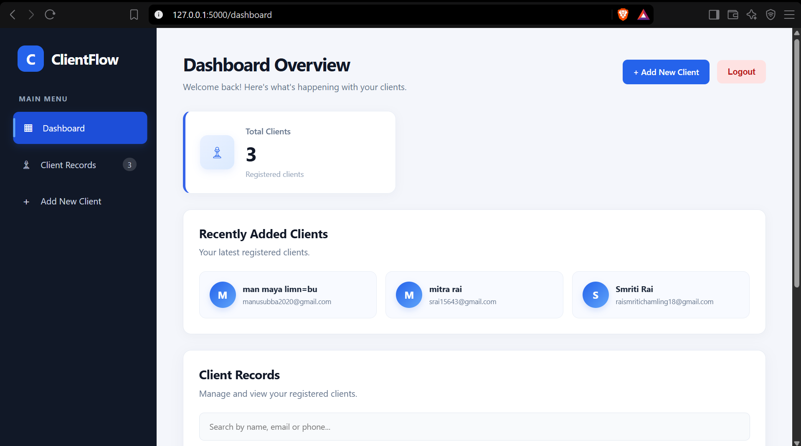
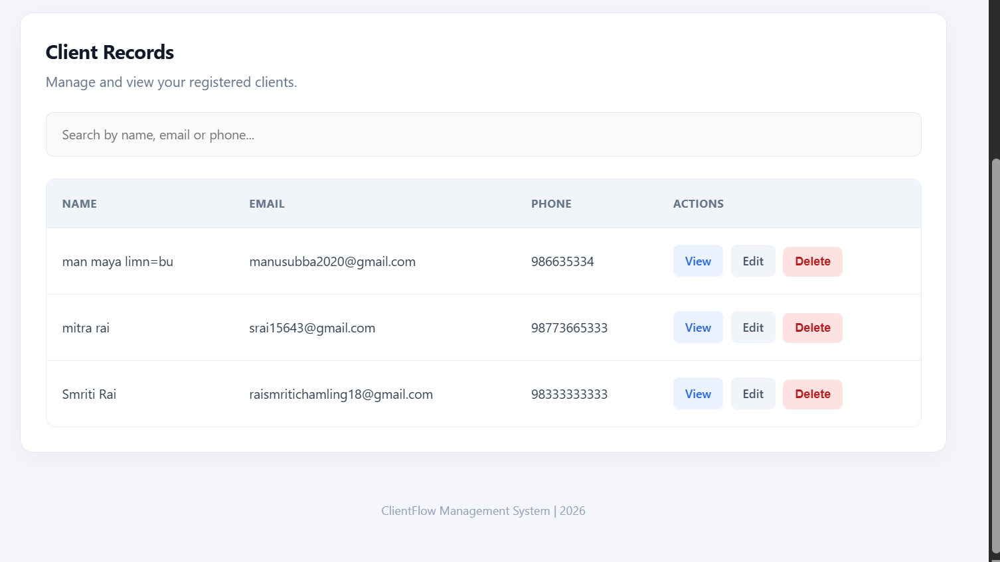
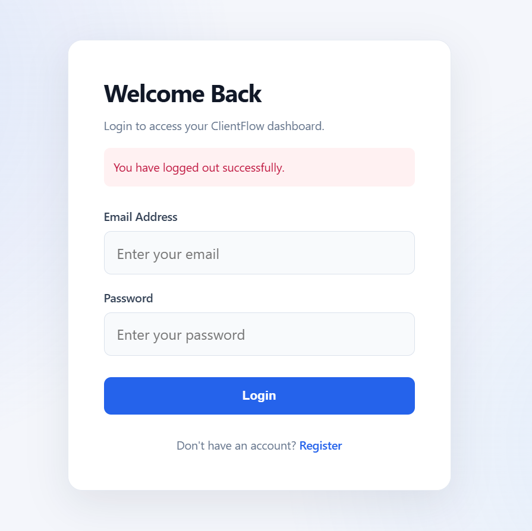
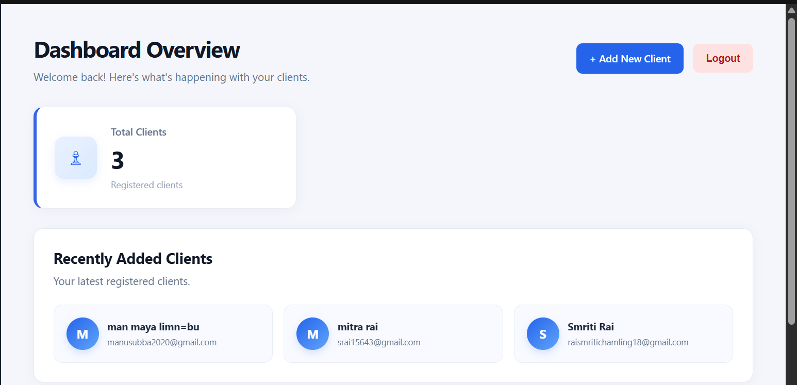

# ClientFlow - Client Management System

ClientFlow is a web-based client management application built with Python and Flask. It helps users manage client information through a simple and professional dashboard.

## Features

- User registration and login
- Secure password hashing
- Individual client records for each user
- Add, view, edit and delete clients
- Search client records
- Dashboard with total client count
- Recently added clients
- Responsive user interface
- SQLite database

## Technologies Used

- Python
- Flask
- Flask-Login
- SQLite
- HTML5
- CSS3
- JavaScript
- Git

## Installation

1. Clone the repository:

   git clone YOUR_GITHUB_REPOSITORY_URL

2. Open the project folder:

   cd ClientManagementSystem

3. Create a virtual environment:

   python -m venv venv

4. Activate the environment on Windows:

   .\venv\Scripts\Activate.ps1

5. Install dependencies:

   pip install -r requirements.txt

6. Create a `.env` file in the project folder:

   SECRET_KEY=your-generated-secret-key

7. Start the application:

   python app.py

8. Open your browser:

   http://127.0.0.1:5000

## Security

- Passwords are stored using secure password hashing.
- Flask secret keys are loaded from environment variables.
- Database files and environment files are excluded from Git.

## Project Status

Currently developed as a portfolio project.

## Author

Smriti Rai

## Application Screenshots

### 1. Dashboard

### 2. Client Records

### 3. Login Portal

### 4. Dashboard Overview

